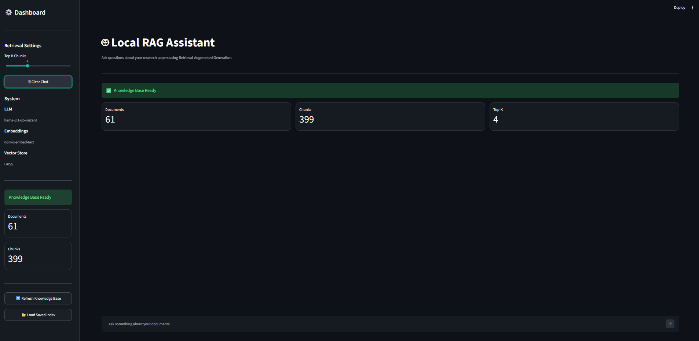
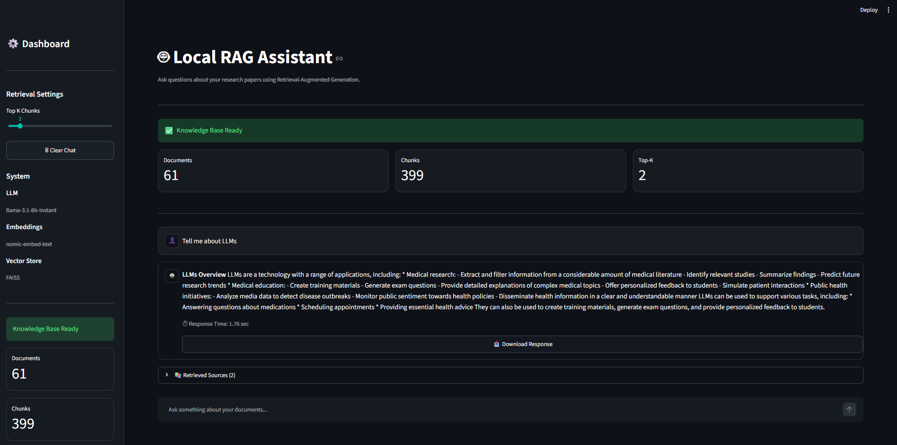
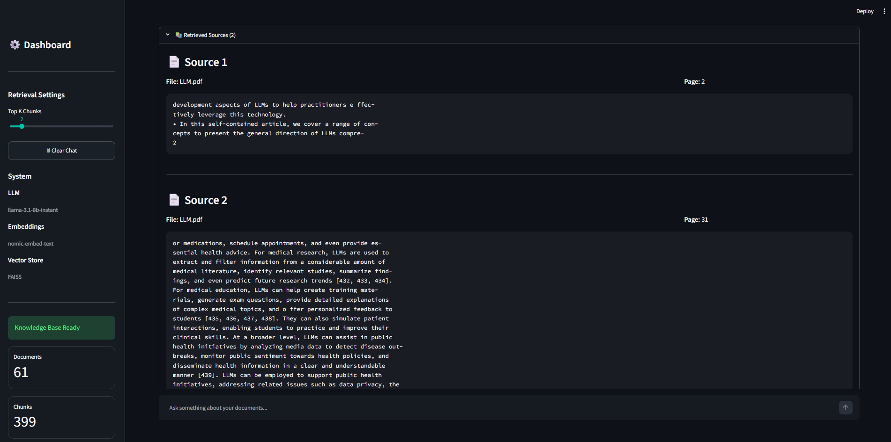

# Local RAG Assistant

A single-user portfolio prototype for asking questions about text-based PDFs.
It uses Streamlit, LangChain, local Ollama embeddings, FAISS, and Groq generation.
This is independent portfolio work; live answer quality and deployment readiness
must be supported by measured evidence before making broader claims.

## What works

- Discover PDFs in `research_papers/` and rebuild when content or chunk settings change.
- Reuse an unchanged index across interactions and restarts.
- Stream answers, display retrieved file/page evidence, and download responses.
- Expand contextual follow-ups with bounded recent history; clarify short ambiguous references.
- Refuse when no retrieved passages pass the configured score threshold.
- Keep answer evidence and timing available while the session remains open.
- Verify saved index artifact sizes/checksums and embedding/chunk configuration.
- Run provider-free regression checks and a synthetic evaluation with quality thresholds.

## Data flow and privacy

```text
Text PDFs -> loader -> chunks -> Ollama embeddings -> local FAISS index
Question + recent history -> retrieval -> evidence + question + history -> Groq
Groq streamed answer -> Streamlit -> retrieved evidence for human inspection
```

**Document processing is not entirely local.** Questions, recent conversation
history, and retrieved PDF text are sent to Groq. Do not use confidential files
unless you are permitted to share their contents with that provider. Chat history
is session-only. Clear Chat removes it from the current session; filesystem PDFs,
indexes, and application logs are separate data stores.

Source IDs such as `[S1]` map to the retrieved evidence panels. They help a user
inspect answers; they do not automatically establish factual support for every
claim. Instructions in documents are treated as untrusted prompt content, but
prompt-injection resistance and live answer faithfulness still require evaluation.

## Quick start with Docker Compose

Install Docker with the Compose plugin. The initial run needs network access to
download images, Python dependencies, and the Ollama embedding model. Ensure your
machine has space and memory for these downloads and your PDF collection; no
minimum hardware benchmark has been established for this prototype.

```bash
git clone https://github.com/sunshine-engineer/Intelligent-Document-QA-Chatbot.git
cd Intelligent-Document-QA-Chatbot
cp .env.sample .env
# Edit .env and set GROQ_API_KEY to your own key, without committing it.
docker compose up --build
```

Open <http://localhost:8501>. Place readable, text-based PDFs in
`research_papers/`. The first session builds the index; **Refresh Knowledge Base**
forces a rebuild. Indexing works without a Groq key; answering requires a key.
The configured models must be available in your provider account/runtime.

PostgreSQL is an optional, currently unused development profile. It is not part
of the working document-QA data path.

## Native development

Install Python 3.12, `uv`, and Ollama using their official installation instructions:
[Python](https://www.python.org/downloads/),
[uv](https://docs.astral.sh/uv/getting-started/installation/),
[Ollama](https://docs.ollama.com/quickstart), and
[Groq API keys](https://console.groq.com/keys).

```bash
uv sync --all-groups --frozen
cp .env.sample .env
# For native execution, set OLLAMA_HOST=http://localhost:11434 in .env.
# Set GROQ_API_KEY for answers. Keep the terminal running Ollama open.
ollama serve
```

In a second terminal:

```bash
ollama pull nomic-embed-text:latest
uv run streamlit run app.py
```

The development container and Docker image use the same lock file; their Python
environments live at `/app/.venv` and `/opt/venv`, respectively.

## Configuration

| Variable | Default | Purpose |
|---|---|---|
| `GROQ_API_KEY` | empty | Required for generated answers |
| `LLM_MODEL` | `openai/gpt-oss-20b` | Groq generation model |
| `EMBEDDING_MODEL` | `nomic-embed-text:latest` | Ollama embedding model |
| `OLLAMA_HOST` | `http://ollama:11434` | Use `http://localhost:11434` for native execution |
| `PDF_DIRECTORY` | `research_papers` | Input text PDFs |
| `INDEX_DIRECTORY` | `faiss_index` | Generated local index; Compose overrides this internally |
| `CHUNK_SIZE` / `CHUNK_OVERLAP` | `1000` / `200` | Characters per chunk/overlap; changes invalidate saved chunks |
| `DEFAULT_TOP_K` / `MAX_TOP_K` | `4` / `10` | Retrieval limits |
| `RETRIEVAL_RELEVANCE_THRESHOLD` | `0.35` | Heuristic cutoff; needs calibration on real documents |

Generation requests use a 30-second provider timeout, two configured retries,
and a 1,024-token output cap. Ollama requests use a 60-second timeout. Questions
are limited to 4,000 characters; generation history to 6,000 characters and
evidence text to 16,000 characters. These are character caps, not exact tokenizer
budgets. Parsing and full-corpus indexing remain synchronous.

## Validation and demonstration

```bash
uv run black --check .
uv run ruff check .
uv run mypy
uv run python -m pytest --cov
uv run python scripts/streamlit_smoke.py
uv run python evaluation/run_offline.py --output evaluation-results.json
```

The synthetic fixture uses keyword retrieval and fake generation. After correcting
its formulas and excluding clarification-only cases from retrieval denominators,
its expected Recall@K, MRR, evidence-pair precision, answer/refusal decision
accuracy, and clarification accuracy are all 1.0. These are regression baselines,
not measured live Groq/Ollama quality. `citation_correctness` in the JSON output
means document/page pair precision, not semantic claim verification.

Tests also execute Streamlit sessions and real FAISS persistence/search with
local deterministic embeddings. See [quality gates](docs/quality-gates.md),
[bug-fix status](docs/portfolio-fix-status.md), and the
[manual demonstration checklist](docs/prototype-demo.md). A current recorded
demonstration and real-provider evaluation remain outstanding.

## Screenshots

These are historical screenshots and may differ from the current controls.





## Limits and scope

- Single-user local prototype: no authentication, tenant isolation, or writer locking.
- Chat history is lost when its session ends. No API, worker, or database integration exists.
- Only text PDFs are supported; scanned/image PDFs need external OCR. No robust
  per-file failure isolation, upload interface, or document viewer is implemented.
- Every changed corpus is fully re-embedded. Incremental/hybrid retrieval and reranking are optional extensions.
- Public hosting requires separate access control, TLS, private provider networking,
  quotas, and deployment validation. The FastAPI and GCP documents are future plans.
- FAISS persistence includes a pickle document store. Only load application-generated
  artifacts from a trusted directory. Checksums detect corruption; they do not
  authenticate files when someone can replace the manifest as well.

Read [local recovery instructions](docs/local-operations.md) and
[container architecture](docs/container-architecture.md) before resetting state.
Code is covered by [MIT](LICENSE); bundled PDFs have separate rights and are
not relicensed by the code license. See [sample document notes](research_papers/README.md).
